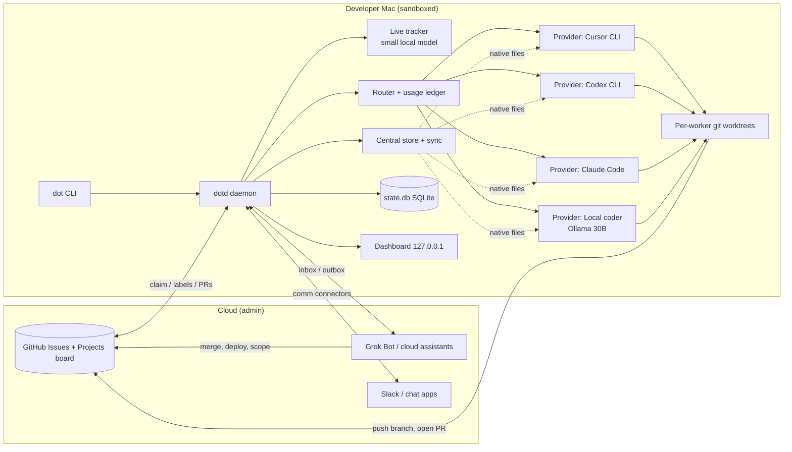

# DOT: design

Status: draft for review. Docs only; no implementation in this PR.

## 1. Vision

`agents` is a lightweight, CLI-first, sandboxed local agent framework. A developer with ordinary
subscriptions (for example a Cursor plan, a ChatGPT plan that includes Codex CLI, a Claude plan, a
cloud assistant such as Grok Bot) and a capable Mac connects all of them, plus a local model, into
one control plane called **DOT**. DOT gets the most finished work out of each plan's usage limits by:

- sending only the hard parts to paid plans and everything cheap (triage, summaries, pre-reading,
  micro-fixes) to a local model;
- routing each task to the worker with the most headroom, and resting workers that hit a limit;
- keeping one source of truth for rules, skills, hooks and memory, synced into every tool's native
  format so they never drift;
- running everything inside a sandbox, controlled from one CLI, with humans (or cloud admin bots)
  making every merge and deploy decision.

Non-goals: being an LLM gateway or proxy, scraping credentials or reusing another tool's tokens,
replacing the vendors' own CLIs, or hosting anything on the public internet.

DOT generalises a proven home-grown setup (a shell worker pool over GitHub issues with label
routing, rework mode, usage-limit hand-over and a Cursor-to-Codex knowledge sync).

## 2. Architecture



Flow: an issue labelled for DOT appears on the board → the router picks a worker by label and
headroom → the local model pre-reads the issue and repo and writes a compact brief → the worker runs
headless in its own worktree inside the sandbox → DOT runs guards (tests, secrets scan), commits
signed, pushes a branch and opens a PR → the tracker posts status → humans or the cloud admin
review, merge and deploy. Administrative work (scoping, decisions, board grooming, docs, merge and
deploy calls) is escalated to cloud assistants through the hand-off outbox.

## 3. Components

| Component | Responsibility |
|---|---|
| `dot` CLI | Single entry point (section 8). Thin client over the daemon's local socket. |
| `dotd` daemon | Long-running supervisor started by `dot up`: worker pool, scheduler, event log. Exits cleanly on `dot stop`. |
| Provider adapters | One per agent CLI or subscription (section 4). Uniform interface: login, run, resume, usage, sync. |
| Router | Picks task → worker using labels, headroom, cool-downs and task size (section 6). |
| Usage ledger | Records measured and estimated usage per provider and window. |
| Live tracker | Small fast local model that turns raw events into "who is doing what, where, status, next". |
| Local aide | 30B coder model for micro tasks, pre-reading and summarising for every other worker. |
| Central store + sync | `~/.dot/store` source of truth rendered into native files (section 5). |
| Task source | GitHub Issues + Projects v2 via `gh` (section 7). |
| Sandbox manager | Seatbelt by default, Docker/Lima optional (section 9). |
| Guards | Pre-push secrets scan, branch policy, signed commits, test gate. |
| Dashboard | Read-mostly localhost web UI (section 10). |
| Comm connectors | Slack first, others later (section 11). |
| Hand-off broker | File + GitHub inbox/outbox for Grok Bot and other cloud assistants (section 12). |

## 4. Provider connectors (adapters)

Every subscription or agent CLI is a **provider adapter**, a small Python class registered by entry
point, so third parties can add one without touching core. `dot auth <provider>` only ever invokes
the vendor's official login; DOT never reads, copies or stores the resulting credentials.

```python
class Provider(Protocol):
    id: str                      # "codex", "cursor", "claude", "ollama", "grok", ...
    kind: Literal["worker", "aide", "handoff"]
    def detect(self) -> Detection            # binary path, version, logged in?
    def login(self) -> Command               # official login command, run interactively
    def run(self, task: Brief, wt: Path, sandbox: SandboxSpec) -> Command
    def resume(self, session_id: str, prompt: str, wt: Path) -> Command
    def parse_events(self, stream) -> Iterator[Event]   # session id, tokens, limit hits, result
    def usage(self) -> UsageSnapshot         # measured if possible, else Estimated
    def limit_patterns(self) -> list[str]    # fallback regexes for limit errors
    def sync_targets(self) -> list[SyncTarget]  # where native knowledge files go
```

### First-class providers

| Provider | Login | Headless run | Resume | Sandbox flags | Usage / limits | Native knowledge targets |
|---|---|---|---|---|---|---|
| **Codex CLI** (`codex`) | `codex login` (ChatGPT sign-in) | `codex exec --json -o <file> -C <wt> "<brief>"`; `--approve-for-me` or `-s workspace-write` | `codex exec resume <id>` or `--last` | `-s read-only\|workspace-write`; Seatbelt on macOS; `[sandbox_workspace_write] network_access` | **Measured**: `codex app-server` `account/rateLimits/read` gives `usedPercent`, `windowDurationMins`, `resetsAt`; rollout `token_count.rate_limits` in `~/.codex/sessions` (null in exec mode today); `/status` in TUI | `AGENTS.md` (repo + `~/.codex/AGENTS.md`), `~/.agents/skills` / `.agents/skills`, `~/.codex/hooks.json`, `config.toml` (`[mcp_servers]`, profiles) |
| **Codex + Ollama** (local coder via Codex harness) | none (local) | `codex exec --oss --local-provider ollama -m <model>` | same as Codex | same as Codex | Local: tokens/s and wall time only | same as Codex |
| **Cursor CLI** (`cursor-agent` / `agent`) | `cursor-agent login` | `cursor-agent -p --output-format stream-json --trust --sandbox enabled --workspace <wt> "<brief>"` (`--force` only inside container mode) | `create-chat` → `--resume <chatId>` | `--sandbox enabled` (Seatbelt, default-deny network proxy), `--mode plan\|ask` for read-only | **Partial**: `/usage` in TUI shows included-usage meters and reset date; `stream-json` result event carries token usage; no scriptable remaining-quota call → **estimated** + limit-error detection | `.cursor/rules/*.mdc`, `.cursor/skills/<n>/SKILL.md`, `.cursor/hooks.json`, `.cursor/mcp.json`, root `AGENTS.md` |
| **Claude Code** (`claude`) | `claude` → `/login` (claude.ai plan) | `claude -p --output-format stream-json --verbose --permission-mode dontAsk --allowedTools ... "<brief>"` | `--resume <session-id>` / `--continue` | Claude's own sandbox setting + Seatbelt wrapper from DOT; `--allowedTools` allow-list | **Measured-ish**: status-line JSON exposes `rate_limits` windows with `used_percentage` and `resets_at`; `/usage` shows 5-hour session and weekly bars; otherwise estimate | `CLAUDE.md`, `.claude/skills/<n>/SKILL.md`, `.claude/settings.json` (hooks, permissions), `.mcp.json` |
| **Ollama** (local models) | none | HTTP `POST /api/chat` on 127.0.0.1:11434 | stateless (DOT keeps the transcript) | network: loopback only | Exact token counts from response (`prompt_eval_count`, `eval_count`, durations) | system prompt rendered from store |
| **Grok Bot** (and other cloud assistants) | none (DOT never holds its credentials) | **hand-off only**: writes to outbox (section 12) | thread id in outbox file / issue | n/a | No API: DOT records what it escalates; Grok Bot reports usage on request | import of exported memory/skills/routines |

Later adapters (same interface): Gemini CLI, Aider, OpenCode, Cursor/Codex cloud agents (behind the
`worker:cloud` label, never auto-run without approval).

Honesty rule: every usage number in DOT carries `source = measured | reported | estimated`, and the
dashboard shows it.

## 5. Central store and sync

One directory, one format: Markdown with YAML frontmatter for prose (rules, skills, memory,
workflows, agents) and TOML for config (hooks, integrations, providers). Versioned with git.

```
~/.dot/
  config.toml             # providers enabled, routing weights, sandbox mode, comm connectors
  state.db                # SQLite: tasks, workers, sessions, usage, events (section 13)
  store/
    rules/*.md            # frontmatter: always | globs | description
    skills/<name>/SKILL.md (+ scripts/, references/)
    memory/*.md           # durable facts; imported Grok Bot memory lands here
    guardrails/*.toml     # deny lists: paths, commands, git verbs
    hooks/hooks.toml      # neutral events -> scripts in hooks/scripts/
    workflows/*.md        # e.g. pick → branch → test → PR
    agents/*.md           # role prompts (tracker, aide, reviewer)
    integrations/*.toml   # MCP server names + commands (secrets by reference only)
    utcp/*.json           # UTCP manuals / call templates
  handoff/{inbox,outbox,archive}/
  logs/
```

A project can carry its own `.dot/store/` that overlays the user store (project wins).

**Neutral hook events** and their native mapping:

| DOT event | Cursor (`hooks.json` v1) | Codex (`hooks.json`) | Claude Code (`settings.json`) |
|---|---|---|---|
| `before_shell` | `beforeShellExecution` | `PreToolUse` matcher `Bash` | `PreToolUse` matcher `Bash` |
| `before_read` | `beforeReadFile` | partial: `PreToolUse` command scan | `PreToolUse` matcher `Read` |
| `after_edit` | `afterFileEdit` | `PostToolUse` `apply_patch` | `PostToolUse` `Edit\|Write` |
| `stop` | `stop` | `Stop` | `Stop` |
| `session_start` | `sessionStart` | `SessionStart` | `SessionStart` |

One bridge script (`dot hook <event>`) is installed as every native hook; it translates the native
JSON payload and runs the store's scripts. This generalises the proven Codex `cursor-bridge`.

**Sync targets** (`dot sync`, also run before every task):

| Store item | Cursor | Codex | Claude Code | Local models |
|---|---|---|---|---|
| rules | `.cursor/rules/dot-*.mdc` | generated section in `~/.codex/AGENTS.md` (always + "applies to globs") | generated block in `CLAUDE.md` / `~/.claude/CLAUDE.md` | compact system prompt |
| skills | `.cursor/skills/<n>` symlink | `~/.agents/skills/<n>` symlink | `.claude/skills/<n>` symlink | index only |
| hooks | `.cursor/hooks.json` → `dot hook` | `~/.codex/hooks.json` → `dot hook` (user trusts once in `/hooks`) | `.claude/settings.json` hooks → `dot hook` | DOT runs them itself |
| MCP / integrations | `.cursor/mcp.json` | `config.toml [mcp_servers]` | `.mcp.json` | n/a |
| UTCP | exposed via `utcp` CLI (code-mode) or its MCP server | same | same | DOT calls UTCP directly |
| memory | rule `dot-memory.mdc` | AGENTS.md section | CLAUDE.md section | retrieval by tracker |

Drift control: generated files carry a `generated by dot sync, do not edit` header and a content
hash; `dot sync --check` fails if a native file was hand-edited, and `dot sync --adopt` pulls the
edit back into the store. DOT only manages files it generated (marker + hash), never user files.
Secrets are never synced: integrations reference env var names or a keychain item, not values.

## 6. Routing and usage algorithm

**Two local models** (see ADR 0005): a 30B coder (e.g. `qwen3-coder:30b`) as the local aide and
`worker:local`, and a small fast model (e.g. `qwen3:4b` or `llama3.2:3b`) as the always-on tracker.
Measured on an M2 Max: the 30B coder processes prompts at ~100 tok/s at long context, so a 36k-token
agent prompt took ~13 minutes for a tiny fix. Therefore local jobs get a **context budget**
(default 8k prompt tokens for the 30B, 4k for the tracker) and DOT pre-reads and trims, instead of
handing a local model a full agent harness prompt.

**Local aide duties for every worker**:
1. Triage: classify a new issue (size S/M/L, area, suggested worker label).
2. Pre-read: summarise the issue, linked PR review and touched files into a ≤1.5k-token brief, so
   paid workers start warm and spend fewer tokens.
3. Micro tasks: S-sized fixes (typos, renames, lint fixes, docs) run fully locally.
4. Summarise: compress worker logs into status lines for the tracker, Slack and hand-offs.
5. Pre-review: a quick local diff check before a PR is opened.

**Picking** (each idle worker, every tick or on event):

```
eligible(task, w) = label allows w            # worker:<id> pins; unpinned -> default pool
                 and w.healthy and not cooling(w)
                 and task.size <= w.max_size
score(task, w)   = headroom(w) * fit(task.size, w) * cost_weight(w) - switch_penalty(task, w)
headroom(w)      = 1 - max(used_fraction over w's windows)          # measured or estimated
cost_weight      = local 1.0 for S, 0 for L;  paid plans rise as their window resets soon
```

Take the oldest eligible task maximising score; claims are atomic (SQLite transaction + issue
label swap), so two workers never take the same issue.

**Usage tracking**
- Measured: Codex rate-limit windows (app-server), Ollama token counts, Claude status-line windows.
- Estimated: Cursor (and any provider without a quota API): DOT counts runs, tokens from
  `stream-json` result events, and wall time per window, calibrated each time a limit is hit
  ("limit reached after N tokens in this window" becomes the new estimate).
- Reported: Grok Bot usage as told on request; escalations counted by DOT.

**Rotation and cool-down**
- A limit is detected from the provider's structured event or, as fallback, the adapter's
  `limit_patterns` on the last output lines.
- On a limit: mark the worker `cooling` until the provider's `resetsAt` if known, else a default
  cool-down (3 h, configurable, doubled on repeated hits within 24 h); hand the in-flight task to
  the next eligible worker **on the same branch and worktree** with a "continue from git status"
  brief; when every paid worker is cooling, fall back to the local coder for S/M tasks and pause L.
- Soft throttle: when a measured window passes 80%, only S/M tasks; at 95%, finish current task
  only. Weekly/monthly windows are budgeted per day so one day cannot burn the week.

## 7. Task source of truth

GitHub Issues + a Projects v2 board (Backlog → Ready → In progress → In review → Done).

Labels: `dot:queue` (ready for a worker), `dot:wip`, `dot:done`, `dot:blocked`, and routing pins
`worker:cursor | worker:codex | worker:claude | worker:local | worker:cloud`. `worker:cloud` is
never auto-run; it needs explicit approval.

Lifecycle: claim (`dot:queue`→`dot:wip`, card → In progress) → branch `<worker>/issue-<n>` from the
configured base → work → guards → signed commit → push → PR with `Closes #n` (card → In review,
`dot:done`) → pick next. **Rework**: if the issue has an open PR, the worker checks out that PR's
branch, puts the review comments into the brief and pushes to the same branch; it counts as done
only when the PR head SHA changes. Humans and cloud admin bots merge and deploy; DOT never does.

## 8. CLI

| Command | Purpose |
|---|---|
| `dot init` | Create `~/.dot`, detect installed CLIs and Ollama, write `config.toml`, offer labels/board setup on a repo. |
| `dot auth <provider>` | Run the provider's official login (`codex login`, `cursor-agent login`, `claude /login`); `dot auth --list` shows status. |
| `dot up [--workers a,b]` | Start the daemon and idle workers; resume paused sessions first. |
| `dot status [--json]` | Workers (what, where, status, next), queue, cooling, usage with source. |
| `dot next [--dry-run]` | What each idle worker would pick next and why; without `--dry-run`, claim and start. |
| `dot run <issue>` | Run one issue in its proper worker. |
| `dot stop [worker]` | Stop workers gracefully; tasks stay claimed and resume on `dot up`. |
| `dot sync [--check\|--adopt]` | Render the central store into native formats. |
| `dot usage` | Per-provider windows, measured vs estimated, cool-downs. |
| `dot dash` | Open the localhost dashboard. |
| `dot handoff [list\|send\|import]` | Grok Bot inbox/outbox; import exported memory/skills/routines. |
| `dot connect <chat>` | Configure a communication connector (Slack first). |
| `dot logs [worker]` | Tail logs. |
| `dot doctor` | Check binaries, logins, sandbox, signing, Ollama models, hooks trusted. |

**Pause and resume**: the daemon records each worker's session id (Cursor chatId, Codex session id,
Claude session id) and worktree in `state.db`. If the Mac sleeps the processes freeze; on wake or
on `dot up`, DOT checks each session and resumes it (`cursor-agent --resume <chatId>`,
`codex exec resume <id>`, `claude --resume <id>`) with "you were interrupted; check git status and
continue", or restarts from the brief if the session is gone.

## 9. Sandbox and security model

**Default: macOS Seatbelt** (ADR 0002), the same mechanism Codex and Cursor already use. DOT runs
each worker in its own git worktree with the vendor sandbox switched on (`codex -s workspace-write`
or `--approve-for-me`, `cursor-agent --sandbox enabled`, Claude permission allow-lists) and wraps
the whole worker process in a DOT Seatbelt profile:
- write: the worker's worktree, its temp dir, tool caches; read: the repo and toolchains;
- deny read: `~/.ssh`, `~/.aws`, `~/.config/gh`, `~/.codex/auth.json`, keychains, `**/.env*`,
  `~/.dot/secrets`, other worktrees;
- network: default deny except the provider's own API endpoints (the vendor CLI needs them),
  `127.0.0.1:11434` for Ollama, and package registries only when the task asks and policy allows.

**Optional container/VM mode** (`sandbox = "docker" | "lima"`): the worktree is mounted into a
container with no host home directory, egress through an allow-list proxy; useful for untrusted
repos and for `--force`/full-auto modes. Vendor logins stay on the host, so container mode is best
for local models and for CLIs that support headless auth tokens issued by their own login flow.

**Secrets**: agents never read `.env` files or credentials (Seatbelt deny + `before_read` and
`before_shell` hooks). DOT itself does not store provider tokens; the vendor CLIs keep their own.
Chat connector tokens live in the macOS Keychain.

**Git policy** (enforced in three layers: worker prompt, `before_shell` hook, and DOT's own push
step):
- never push to `main` or `dev` (configurable protected list), never force-push, never merge, never
  delete remote branches; workers push only `<worker>/issue-<n>` branches;
- DOT, not the worker, makes the final commit, with the user's normal signing (e.g. 1Password SSH
  signing) left on; a signing failure stops the task, it is never bypassed;
- pre-push secrets scan over the diff (gitleaks if installed, else a built-in regex set for keys,
  tokens and private keys) blocks the push;
- recommended GitHub branch protection: require PR + review on `main`/`dev`, block force-push.

## 10. Dashboard

`dot dash` serves a localhost-only (127.0.0.1, random port, per-session token in the URL) web UI
from the daemon. Panels: **Workers** (current task, worktree, branch, status, session, last
activity, next pick), **Tasks** (board mirror, claims, rework), **Usage** (windows per provider with
measured/estimated badges, cool-downs, trend), **Memory / Rules / Skills / Hooks** (store contents,
sync status, drift), **Logs** (live tail per worker), **Hand-offs** (inbox/outbox), **Chat** (recent
connector traffic). Read-mostly; actions limited to stop/resume worker, re-run sync, approve a
`worker:cloud` task. Server-rendered HTML + small JS; no build step.

## 11. Communication connectors

Same adapter pattern as providers:

```python
class CommConnector(Protocol):
    id: str                                  # "slack", "discord", "telegram", "teams", "whatsapp", "email"
    def connect(self) -> None                # official app/bot install; token in Keychain
    def post_status(self, msg: StatusMsg) -> None
    def post_handoff(self, h: Handoff) -> None
    def inbound(self) -> Iterator[Command]   # parsed commands from allowed senders only
```

- **Slack (v0.4)**: Slack app in Socket Mode (no public endpoint needed): status posts to a channel
  (task claimed, PR opened, limit hit, worker idle), hand-off threads, and slash/mention commands
  (`status`, `next`, `stop <worker>`, `approve <issue>`, `handoff`).
- Later: Discord, Telegram, Microsoft Teams, WhatsApp (Business API), email (IMAP/SMTP).
- **Allow-list**: `[comm.allow]` lists user ids per connector who may command DOT; everyone else is
  ignored and logged. Destructive or approval commands may require a second factor (confirm on the
  Mac or in the dashboard). Commands can never trigger merge, deploy or a push to protected
  branches.

## 12. Grok Bot integration and hand-off protocol

Grok Bot has no external API that controls its usage, so DOT controls it by **deciding what gets
escalated**: only administrative work (scoping, decisions, board updates, docs, merge and deploy
calls) goes up, batched, with summaries written by the local model.

**Import format** (`dot handoff import <dir>`): Grok Bot exports files that DOT maps into the store:

```
grok-export/
  manifest.toml        # version, exported_at, source = "grok-bot"
  memory/*.md          # -> store/memory/ (frontmatter: id, updated, tags)
  skills/<n>/SKILL.md  # -> store/skills/<n>/
  routines/*.toml      # -> store/workflows/ (schedule, trigger, steps) as reference, not auto-run
  usage.json           # optional: as reported, source = "reported"
```

**Hand-off protocol**: one message = one Markdown file with frontmatter, mirrored to a GitHub issue
labelled `dot:handoff` so a cloud assistant can read it either way.

```yaml
---
id: ho-2026-11-01-0007
from: dot            # or grok-bot
to: grok-bot         # or dot
type: decision | scope | board | docs | merge-call | deploy-call | status | usage-report
refs: [ "issue#42", "pr#57" ]
priority: normal
reply_by: 2026-11-02T10:00+05:30
status: open | answered | closed
---
Summary (≤10 lines, local-model written), the question, options with DOT's recommendation.
```

Outbox: `~/.dot/handoff/outbox/` + issue. Inbox: `~/.dot/handoff/inbox/` (files written by the
assistant via a synced folder or repo) or issue comments starting with `/dot`. DOT applies answers
(labels, board moves, new issues) and archives the thread.

## 13. Data model (SQLite, `~/.dot/state.db`)

```
providers(id, kind, binary, version, logged_in, enabled, max_size)
workers(id, provider_id, worktree, status[idle|running|paused|cooling|disabled],
        current_task_id, session_id, pid, started_at, last_activity_at, cooling_until)
tasks(id, repo, issue_number, title, labels, size, pin, state[queued|claimed|running|done|blocked],
      worker_id, branch, pr_number, rework_pr, head_sha_at_claim, brief_path, claimed_at, done_at)
sessions(id, worker_id, task_id, provider_session_id, kind[new|resume|handover], started_at, ended_at, exit)
usage_windows(provider_id, window[5h|weekly|monthly|daily], used_fraction, resets_at,
              source[measured|reported|estimated], observed_at)
usage_events(id, provider_id, task_id, tokens_in, tokens_out, wall_s, limit_hit, ts)
handoffs(id, direction, type, refs, status, path, issue_number, created_at, answered_at)
events(id, ts, actor, kind, task_id, worker_id, payload_json)   # append-only audit log
```

## 14. Milestones

- **v0.1** minimal CLI + worker pool + status: `init`, `auth` (official logins), `up`, `status`,
  `next`, `run`, `stop`; Codex, Cursor and Ollama adapters; label routing over GitHub issues;
  worktrees; limit detection + cool-down + same-branch hand-over; signed commits; pre-push scan.
- **v0.2** central store + `dot sync` (Cursor, Codex, Claude Code), `dot hook` bridge, Claude Code
  adapter, local aide pre-read briefs, usage ledger with measured Codex windows.
- **v0.3** dashboard; tracker model; `dot usage` trends.
- **v0.4** Slack connector; Grok Bot import and hand-off protocol.
- **v0.5** container mode (Docker, Lima) with egress allow-list; more providers (Gemini CLI, Aider,
  OpenCode) and comm connectors.

## 15. Open questions

1. Language/runtime: Python 3.12 via uv (recommended, ADR 0001) vs Go single binary.
2. Default base branch for worker branches: `dev` if it exists, else `main` (recommended).
3. Who makes the commit: DOT for all workers (recommended, keeps signing and scanning in one place)
   vs letting Cursor/Claude commit themselves.
4. Cursor usage: estimation only until Cursor ships a scriptable usage API (recommended) vs
   scraping the dashboard (rejected).
5. Tracker model: `qwen3:4b` (recommended) vs `llama3.2:3b` (faster, weaker at structured output).
6. Default cool-down when no reset time is known: 3 h (recommended).
7. Grok Bot inbox transport: GitHub issues labelled `dot:handoff` (recommended) vs a synced folder.
8. Slack mode: Socket Mode app (recommended) vs incoming webhooks only.
9. License: MIT (recommended, as requested).

## Sources

- Codex CLI: local `codex exec --help` (0.166.0); sandbox, AGENTS.md, hooks, skills:
  https://learn.chatgpt.com/docs/hooks, https://learn.chatgpt.com/docs/build-skills,
  https://github.com/openai/codex/blob/main/docs/sandbox.md; Ollama: https://docs.ollama.com/integrations/codex
- Codex usage: https://github.com/openai/codex/discussions/56932, https://github.com/openai/codex/issues/14728
- Cursor CLI: local `cursor-agent --help` (2026.10.22); https://cursor.com/docs/cli/headless,
  https://cursor.com/docs/cli/reference/parameters, https://cursor.com/docs/hooks,
  https://cursor.com/docs/rules, https://cursor.com/docs/skills, https://cursor.com/docs/cli/changelog
- Claude Code: https://code.claude.com/docs/en/hooks, https://code.claude.com/docs/en/best-practices,
  https://code.claude.com/docs/en/statusline, https://support.claude.com/en/articles/14553413-claude-code-cheatsheet
- UTCP: https://github.com/universal-tool-calling-protocol/utcp-specification (CLI protocol:
  docs/protocols/cli.md), https://github.com/universal-tool-calling-protocol/code-mode
- Small models on M2 Max: https://github.com/enescingoz/mac-llm-bench/blob/main/results/m2/max/speed/README.md,
  https://modelpiper.com/blog/ollama-vs-llamacpp-benchmark-mac
